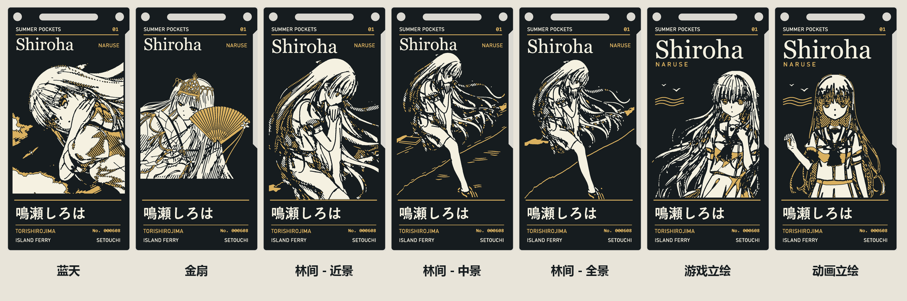
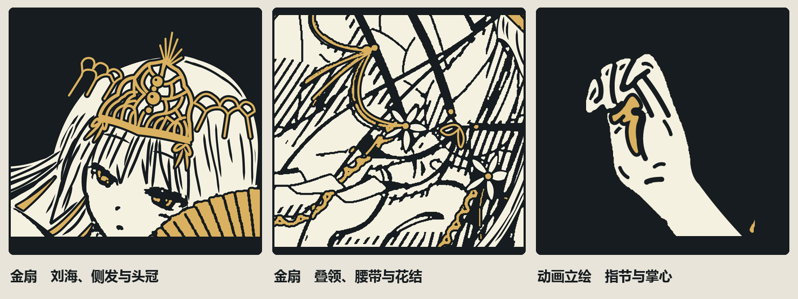

# 鸣濑白羽 · 濑户内船票 PCB

《Summer Pockets》鸣濑白羽主题的双面纪念板。正面以黑色阻焊、白色丝印和局部沉金表现人物。背面取高松至直岛宫浦港的船票为题，船名「あさひ」，日期 06.08。

## 工程与打样文件

五张人物图对应七个可编辑工程，其中林间插画有近景、中景和全景三个取景。每个目录包含嘉立创 EDA 专业版工程、Gerber 压缩包和可放大的正反面矢量预览。

| 款式 | 可编辑文件 | 制造文件 | 预览 |
| --- | --- | --- | --- |
| 蓝天 | [EDA 工程](boards/blue-sky/blue-sky.epro2) | [Gerber](boards/blue-sky/gerber.zip) | [正反面 SVG](boards/blue-sky/preview.svg) |
| 金扇 | [EDA 工程](boards/golden-fan/golden-fan.epro2) | [Gerber](boards/golden-fan/gerber.zip) | [正反面 SVG](boards/golden-fan/preview.svg) |
| 林间 · 近景 | [EDA 工程](boards/riverside-close/riverside-close.epro2) | [Gerber](boards/riverside-close/gerber.zip) | [正反面 SVG](boards/riverside-close/preview.svg) |
| 林间 · 中景 | [EDA 工程](boards/riverside-medium/riverside-medium.epro2) | [Gerber](boards/riverside-medium/gerber.zip) | [正反面 SVG](boards/riverside-medium/preview.svg) |
| 林间 · 全景 | [EDA 工程](boards/riverside-wide/riverside-wide.epro2) | [Gerber](boards/riverside-wide/gerber.zip) | [正反面 SVG](boards/riverside-wide/preview.svg) |
| 游戏立绘 | [EDA 工程](boards/game/game.epro2) | [Gerber](boards/game/gerber.zip) | [正反面 SVG](boards/game/preview.svg) |
| 动画立绘 | [EDA 工程](boards/anime/anime.epro2) | [Gerber](boards/anime/gerber.zip) | [正反面 SVG](boards/anime/preview.svg) |

[下载全部七款](https://github.com/shiroha777/shiroha-ferry-pcb/releases/latest) · [下载蓝天版双面 Gerber](https://github.com/shiroha777/shiroha-ferry-pcb/releases/download/v1.0.1/Shiroha-Blue-Sky-Gerber.zip)

## 看细节

动画立绘的举手保留了蜷指间的空隙，指根和掌心的暗部用沉金表现。金扇礼装沿原图描出不同层次的刘海、鬓发与长发，腰带和袖口以密排线表现叠压暗部。

## 使用

1. 在嘉立创 EDA 专业版导入该款的 `.epro2`，打开 `PCB1`。编辑器用不同颜色区分图层。新版工程默认在编辑视图隐藏底铜、底层丝印和底层阻焊开窗，点击右侧图层的眼睛可重新显示。
2. 点击工具栏的 **2D**，在右侧「板面」切换顶面和底面。板子颜色选黑色，焊盘喷镀选金色，打开丝印显示。顶面为竖排人物，底面船票可横向阅读。[嘉立创 EDA 专业版 2D 预览说明](https://prodocs.lceda.cn/cn/pcb/view-preview-2d/)
3. 选择对应款式的 `gerber.zip` 打样。每个压缩包包含正反面铜层、阻焊开窗、丝印，以及板框、挂绳槽和两个圆孔。下单选双层 FR-4、黑色阻焊、白色丝印、沉金（ENIG）。
4. 每款的 `preview.svg` 由 Gerber 回渲。黑底代表阻焊，白色代表丝印，金色代表开窗露出的沉金铜面。屏幕上的金色是示意色，实物光泽与色调随工艺和光线变化。

## 来源与许可

本项目原创的船票版式、分层制图和 PCB 修改采用 **CERN-OHL-P-2.0**。许可范围、修改说明及第三方来源见 [NOTICE.md](NOTICE.md)。[许可证全文](LICENSE)
